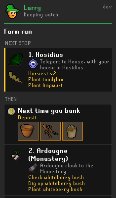
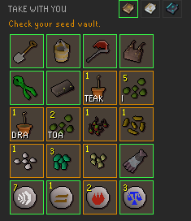
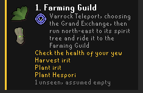
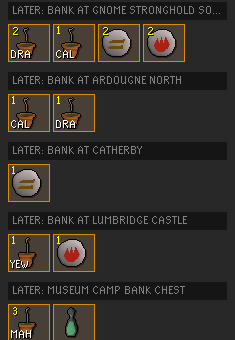
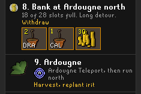
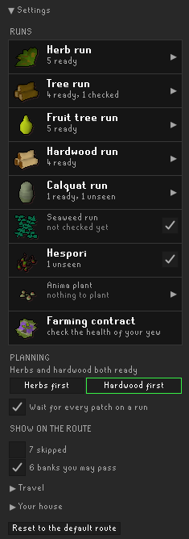

# Larry: Farming Runs

**Larry plans the route. You plant the patches.**
He learns your teleports and unlocks as you play, so there's nothing to set up.

## What sets him apart

- **No setup tabs.** You fill in no patch list, crop list, house or storage.
- **The route comes from what you have.** Larry orders the patches and picks each teleport
  from the unlocks on your account.
- **The plan keeps up.** A new diary reward or quest unlock changes the route the moment the
  game reports it.

## What do I bring?

- Larry builds one list for the run: tools, seeds, compost, and each teleport's runes or items.
- He suggests seeds from your Farming level and what you have in stock.

## Where do I go?

- Each stop names its teleport and the way from the landing to the patch.
- Each stop lists the work waiting there (harvest, check a tree, clear a stump) and what to plant.
- Finished stops drop off, and the next stop moves to the top in gold.

## When the haul won't fit

 

- Larry plans bank stops when the run needs more than one inventory.
- Each bank stop says what to withdraw there and how far out of the way it is.

## Do I have to set anything up?

No. Larry sees what's built in your house when you visit it, and what your Portal Nexus holds
when you open it. The settings at the foot of the panel cover choices only you can make, such
as which runs to do. One button puts them all back to the default route.

**Colours:** green means carried or with the leprechaun, orange means still to fetch from your bank or seed box, gold marks the current stop.

## How to use

1. Install Larry from the Plugin Hub and open his panel.
2. Log in. Larry shows the run that's due.
3. Pack what the carry list asks for.
4. Follow the next stop.

## Planned

Handing the next stop to Shortest Path, and the carry list to an inventory-setup plugin.

## Credits

- Larry's default settings follow the farming route in the
  [BRUHsailer Ironman guide](https://oldschool.runescape.wiki/w/Guide:BRUHsailer) by So Iron
  BRUH and ParasailerOSRS.
- **[RuneLite](https://github.com/runelite/runelite)**, whose Time Tracking plugin code Larry's
  patch tracking is derived from, and whose Item Identification plugin and Varbits table supply
  farming item tags and diary varbit ids.
- **[Quest Helper](https://github.com/Zoinkwiz/quest-helper)** by Zoinkwiz and its
  contributors, for the quest var ids that gate routes.
- **The [Old School RuneScape Wiki](https://oldschool.runescape.wiki/)**, for item, patch and
  teleport facts.
- The [Shortest Path](https://github.com/Skretzo/shortest-path) plugin, whose transport tables
  helped place teleport landing tiles.

Licenses and full attributions: [NOTICE](NOTICE). Larry is BSD 2-Clause ([LICENSE](LICENSE)).

Old School RuneScape and RuneScape are trademarks of Jagex Ltd. Larry: Farming Runs is not
affiliated with or endorsed by Jagex.
